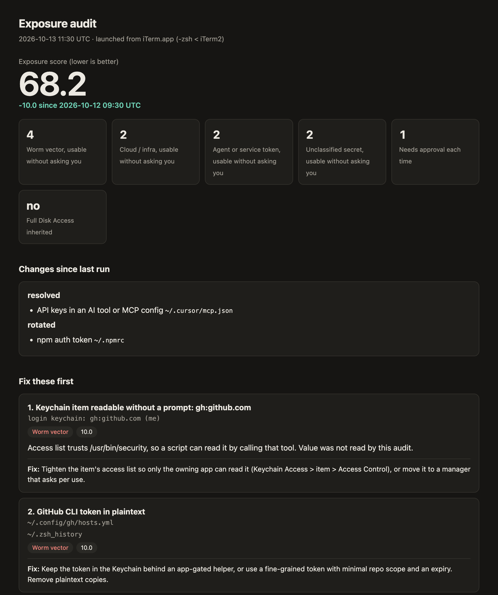
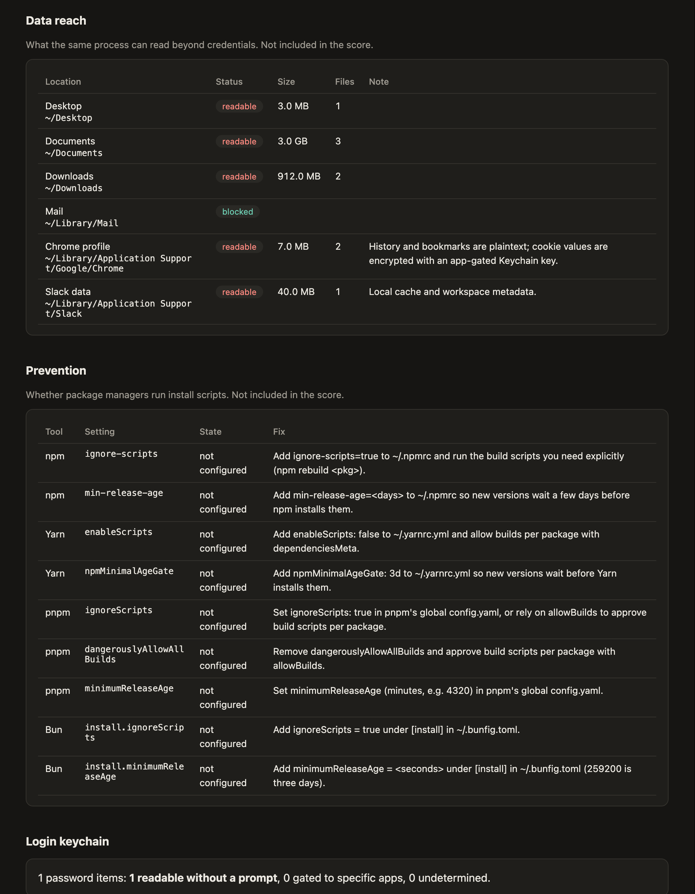

# exposure-audit

A local macOS tool that answers one question:

> What could a malicious install script started from my terminal quietly read or use, and what should I fix first?

It runs as you, from the terminal you launch it in, with no extra privileges. That is the same position as a compromised `npm install`. It finds credentials that process could read, ranks them by how much damage each could do, and names a fix for each. It runs offline in under a minute and never prints or stores a secret value.

The reference threat is the [Shai-Hulud npm worm](https://www.sysdig.com/blog/return-of-the-shai-hulud-worm-affects-over-25-000-github-repositories) (2025). Its `preinstall` hook ran as the logged-in user, collected npm, GitHub and cloud credentials from files and environment variables, then used the stolen GitHub token to spread ([Semgrep](https://semgrep.dev/blog/2025/digging-for-secrets-sha1-hulud-the-second-coming-of-the-npm-worm), [Expel](https://expel.com/blog/the-second-coming-of-shai-hulud/)).

## Screenshots

> These were rendered from the test harness's fake home (`baseFixture`), with fabricated tokens and the committed, sanitized Keychain sample. No real machine was scanned. Regenerate them with [`docs/screenshots.sh`](docs/screenshots.sh).

The score, the changes since your last run, and the ranked "Fix these first" list:



What else the same process can read (not scored), whether your package managers run install scripts, and how many login Keychain items open without a prompt:



Running it with no flags prints a summary in the terminal:

```text
Exposure score (lower is better): 68.2  (-10.0 since 2026-10-12 09:30 UTC)
Findings: 11 · credentials: 11 · worm vectors usable without a prompt: 4
Launched from: iTerm.app (-zsh < iTerm2)
Full Disk Access: no

Fix first:
  1. [10.0] Keychain item readable without a prompt: gh:github.com
       login keychain: gh:github.com (me)
       Fix: Tighten the item's access list so only the owning app can read it (Keychain Access > item > Access Control), or move it to a manager that asks per use.
  2. [10.0] GitHub CLI token in plaintext
       ~/.config/gh/hosts.yml
       ~/.zsh_history
       Fix: Keep the token in the Keychain behind an app-gated helper, or use a fine-grained token with minimal repo scope and an expiry. Remove plaintext copies.
  3. [10.0] npm auth token
       ~/.npmrc
       Fix: Publish with npm trusted publishing (OIDC) so no token lives on disk; if you must keep one, make it granular, read-only, and short-lived. Set ignore-scripts=true.
  ...

Changes since last run:
  resolved: API keys in an AI tool or MCP config (~/.cursor/mcp.json)
  modified: npm auth token (~/.npmrc)

Prevention: 0 of 8 on, 4 safe by default · to fix: npm ignore-scripts and min-release-age, Yarn npmMinimalAgeGate, Bun install.minimumReleaseAge (see -open)
```

## What it checks

- **Known credential files:** about 40 locations, including npm, GitHub CLI, git credentials, AWS (static keys, session credentials, SSO cache), GCP, Azure, Kubernetes, Docker, Terraform, Vault, Cargo, PyPI and RubyGems.
- **AI tools:** Claude Code, Codex, Gemini, Copilot, Cursor, Windsurf, Continue, Zed, Goose and Aider configs, including MCP server tokens.
- **SSH:** private keys (with or without a passphrase), keys loaded in `ssh-agent`, and the 1Password SSH agent.
- **Your shell:** secrets in exported environment variables, shell startup files and shell history.
- **`.env` files:** a sweep of your home directory (or `-roots`). It skips `node_modules` and example files, and halves the score of files committed to git.
- **Login Keychain:** items whose access list lets `/usr/bin/security` (or any app) read them without a prompt. It reads access lists only, never item values. It also checks whether git credential helpers hand out tokens without a prompt, inferred from config and the Keychain.
- **Context:** which app launched the shell, whether a coding agent is in the parent process chain, and whether the terminal has Full Disk Access.
- **Data reach (not scored):** whether Documents, Downloads, iCloud Drive, Mail, Messages, browser profiles, Slack and similar folders are readable, with sizes.
- **Prevention (not scored):** whether npm, Yarn, pnpm and Bun run install scripts and enforce a minimum release age. Each setting is on, off, not configured, or default (not set, but the tool's current release already protects).

## Scoring

Each credential (a unique secret, wherever it appears) is scored once, at the highest weight it earns in any location:

| Class                          | Weight |
| ------------------------------ | ------ |
| Worm vector (npm, GitHub, SSH) | 10     |
| Cloud / infrastructure         | 8      |
| Coding-agent or service token  | 5      |
| Unclassified secret            | 3      |

The weight is then multiplied by:

- × 0.4 if the credential is short-lived
- × 0.5 if an approval is cached for a while (1Password CLI, 1Password SSH agent)
- × 0.1 if it needs your approval every time
- × 0.5 for a dotenv file committed to git

"Fix these first" is ordered by tier, then score, so a worm-vector token always ranks above a pile of cloud keys. If the launching terminal has Full Disk Access, that is pinned to the top and not scored.

## Build

Go 1.26 or later. Standard library only: no dependencies, no cgo.

```sh
go install github.com/kurioscreative/exposure-audit@latest   # installs exposure-audit into $(go env GOPATH)/bin
```

Or from a clone:

```sh
CGO_ENABLED=0 go build -trimpath -o exposure-audit .
```

## Usage

Run it from the terminal (or IDE terminal) you actually install packages from. Different apps get different macOS permissions, so results differ.

```sh
./exposure-audit            # terminal summary
./exposure-audit -open      # also open the full HTML report (deleted after a few seconds)
./exposure-audit -json      # print the snapshot as JSON
```

| Flag             | Effect                                                                                    |
| ---------------- | ----------------------------------------------------------------------------------------- |
| `-open`          | Write the HTML report, open it in your browser, then delete it                            |
| `-json`          | Print the snapshot as JSON instead of the summary                                         |
| `-probe-folders` | Also measure TCC-protected folders such as Documents (may show a macOS prompt)            |
| `-skip-keychain` | Skip the login Keychain access-list check                                                 |
| `-version`       | Print the version and exit                                                                |
| `-roots a,b`     | Directories for the `.env` sweep (default: your home); `~` expands, a missing one exits 2 |
| `-max-depth n`   | Depth limit for the `.env` sweep (default 5)                                              |

Exit codes: `0` complete run; `1` report produced but a collector failed, timed out or was partial (or an output was withheld by the leak check); `2` usage error or unusable state directory. `-h` and `-version` exit `0`.

## Safety guarantees

These are enforced by tests (see [`invariants_test.go`](invariants_test.go) and [`keychain_test.go`](keychain_test.go)):

- **No secret values on screen or at rest.** Values are read into memory, fingerprinted with a salted HMAC, and dropped. Every output is checked for leaks before anything is written. If a secret shows up, the output is withheld.
- **No network.** The binary does not link `net` or `net/http`, and does not read cloud-storage placeholder files that would download on access.
- **Read-only outside `~/.exposure-audit`.**
- **Only four programs are ever run**, by absolute path and never through a shell: `/usr/bin/security`, `/usr/bin/ssh-add`, `/bin/ps`, `/usr/bin/open`. Credential helpers are never run.
- **Keychain item values are never read.** `security dump-keychain` is called with `-a` (access lists), never `-d`.
- **Unprivileged.** No sudo, no entitlements.

## History and privacy

`~/.exposure-audit/` holds a random salt and one JSON snapshot per run. Snapshots contain titles, locations and salted fingerprints, so the next run can tell you what was resolved, modified or new. They never contain secret values or Keychain service and account names. The history is still a map of where your secrets live, and the kind of script this tool models can read it. Delete the folder if that matters more to you than tracking progress.

## Limitations

- **Offline only.** It cannot tell whether a token is still valid or what it is scoped to.
- **Keychain results are inferred** from access and partition lists, so treat them as likely rather than certain.
- **Not every macOS behavior is verified.** Some (for example, Full Disk Access inference and coding-agent detection) are inferred and marked unverified in the code.
- **macOS is the target.** It builds and its tests run on Linux, but the Keychain, data reach and Full Disk Access checks are macOS-only.
- **It does not detect an existing infection or block installs.**

## Development

```sh
./test.sh              # gofmt, go vet, Linux and darwin/arm64 builds, tests
docs/screenshots.sh    # regenerate the README screenshots (macOS, Google Chrome)
```

Tests run the whole tool in-process against a temporary fake home, with fake tokens built at runtime. Never point the tests or the binary at someone else's home directory. [`HANDOFF.md`](HANDOFF.md) has the design and decisions; [`REVIEW.md`](REVIEW.md) tracks review findings.

## Security and license

Report vulnerabilities privately; see [`SECURITY.md`](SECURITY.md). Released under the [MIT license](LICENSE).
